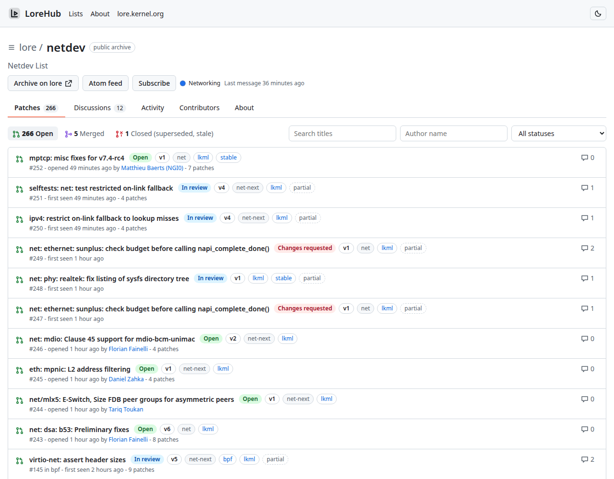
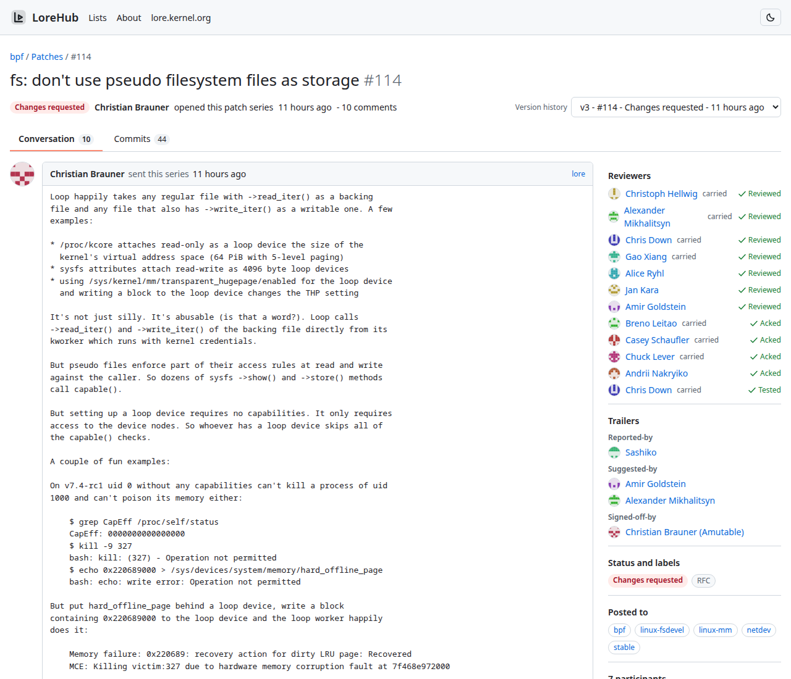

# LoreHub

A GitHub-style view of every mailing list archived on [lore.kernel.org](https://lore.kernel.org/).

* a mailing list is a **repository**
* a patch series is a **pull request**, successive versions (v1, v2, v3) are one PR with a version history
* a non-patch thread is a **discussion** (issue)
* `Reviewed-by`, `Acked-by`, `Tested-by` and NAKs are **review states**
* "Applied, thanks" replies and `[GIT PULL]` threads are **merges**

It is a fully static site: a Python generator (standard library only) writes JSON, and a small
vanilla JS front end renders it. No backend, no database, no tracker, no CDN. Deploys to GitHub Pages
under any sub-path (all links are relative, routes are hash based).


| List page | Patch series page |
| --- | --- |
|  |  |

More screenshots (mobile, dark mode, commits tab, contributor page, served under a sub-path) are in
[docs/screenshots](docs/screenshots). They were taken with headless Chrome from real lore data for
`lkml`, `netdev`, `linux-mm`, `bpf`, `linux-fsdevel`, `dri-devel`, `linux-riscv` and `stable`.

## Run it locally

```sh
python3 -m lorehub all --lists lkml,netdev --out public --state state    # crawl, then build
python3 -m http.server -d public 8000                                     # open http://localhost:8000/
```

`all` is `crawl` followed by `build`. `build` alone rebuilds the site from an existing `state/` directory
without touching the network. Requires Python 3.10 or newer, nothing to install.

Useful options:

| Command | Option | Meaning |
| --- | --- | --- |
| crawl, all | `--lists a,b` | only these lists (default: every list in the manifest) |
| crawl, all | `--budget-min 25` | wall clock budget; unfinished lists are done by the next run |
| crawl, all | `--deep-budget N` | max search-atom requests per run to fill gaps on busy lists (default 0, see below) |
| crawl, all | `--from-cache DIR`, `--save-raw DIR` | replay or record raw HTTP responses, for offline development |
| build, all | `--out public` | output directory |
| build, all | `--base /lorehub/` | base path, used only by `404.html` |
| build, all | `--max-site-mb 300` | site size cap |
| backfill | `--hours 96 --pages 3` | one-off history bootstrap for chosen lists |

## How the data is gathered

* The list of lists is `https://lore.kernel.org/manifest.js.gz`. Each list has one entry per
  public-inbox epoch; the newest `modified` time says when the list last changed.
* Per list activity comes from `https://lore.kernel.org/<list>/new.atom`. The feed carries, per message,
  author, subject, time, message-id (inside the link), the direct parent (`thr:in-reply-to`) and the
  body. **It holds only the 25 newest messages**, so LoreHub accumulates history across runs and keeps
  120 days (see Limitations for the caps).
* A busy list can produce more than 25 messages between two runs (`lkml` peaks at 25 per 3.5 minutes).
  When a gap is detected and `--deep-budget` is set, the crawler fills it with the same host's search
  Atom (`?q=dt:<time>..&x=A`, 200 messages per request, about 1.4 MB). It is **off by default**, in the
  CLI and in the workflow. To enable it on GitHub, set the repository variable `LOREHUB_DEEP_BUDGET`
  (for example `8` requests per run) or pass `deep_budget` when dispatching the workflow.
* Polite by construction: User-Agent `lorehub-bot/0.1 (+https://github.com/lkmlhub/lkmlhub.github.io)`, at most
  2 concurrent requests, at least 0.5 s between request starts, `Retry-After` honoured, exponential
  backoff on 429/503/5xx, a hard stop if the server asks for a long pause, validators
  (`If-None-Match`, `If-Modified-Since`) sent when known, and lists whose manifest `modified` time did
  not change are skipped. lore currently sends no validators, so the manifest time does the work.
* Public-inbox git repositories are never cloned.
* The crawl is resumable: lists are processed least recently fetched first inside a time budget, and a
  failed or partial run never shrinks or corrupts the stored state. A list that could not be refreshed
  keeps its previous state and is flagged stale on the site. One pass over all 359 lists took about 3
  minutes and 60 MB.
* E-mail addresses are never stored or published. Authors are a salted, truncated SHA-256 of the
  address (12 hex characters, used for avatars and contributor pages); bodies are scrubbed; message-ids
  are stored percent-encoded.

## Heuristics

Everything below is guessed from reply text and can be wrong. The same table is on the site's About page.

| Label | Rule |
| --- | --- |
| Merged | a reply from someone other than the author says applied, queued, merged or pulled in its first lines (not a question, not negated), or a `[GIT PULL]` gets such a reply (or a pr-tracker-bot message) |
| Superseded | a newer version exists: same author, same normalised title, higher version, or a RESEND |
| Changes requested | a reply from someone else is a NAK, has a `Nacked-by`, or has inline comments containing requests, and that reviewer has not approved since; only while no newer version exists |
| Reviewed / Acked / Tested | a reply (not quoted) from someone other than the author carries that trailer |
| In review | any reply from someone other than the author |
| Open | no such reply yet |
| Stale | not merged or superseded, no activity for more than 60 days |

Priority: Merged, Superseded, Changes requested, Reviewed, Acked, Tested, In review, Open, then Stale on
top. Tabs show Open, Merged and Closed (superseded or stale) counts per list.

Series are detected from subjects such as `[PATCH v3 2/7]`, `[PATCH net-next v2 0/5]`, `[RFC PATCH]`,
`[RESEND PATCH]`, `[PATCH RFC]`, `[GIT PULL]`, `[PULL]`; `[ANNOUNCE]`, `[BUG]`, `[REGRESSION]` become
discussion labels. A cover letter and its patches form one PR; unthreaded series are joined by author,
version, total and time. A message cross-posted to several lists is one thread (keyed by message-id)
with the other lists shown as chips.

## Deploy to GitHub Pages

1. Push this repository to GitHub (the project page then lives at `https://<user>.github.io/<repo>/`).
2. Settings, Pages, Source: **GitHub Actions**.
3. Settings, Actions, General, Workflow permissions: allow read and write (the workflow also declares
   `contents: write`, `pages: write`, `id-token: write`).
4. Run the `update` workflow once from the Actions tab, or just push to `main`.

`.github/workflows/update.yml` runs every 30 minutes, on manual dispatch and on pushes to `main`. It
checks out `main`, checks out the `data` branch into a subdirectory (creating it on the first run),
runs the tests, crawls for up to 25 minutes, builds the site, force-pushes the data branch as one
squashed commit, uploads the Pages artifact and deploys it. A concurrency group prevents overlapping
runs and the job has a 40 minute timeout. `.github/workflows/ci.yml` runs the tests on pull requests
for Python 3.10, 3.12 and the latest 3.x.

The base path is derived from the repository name (`/<repo>/`, or `/` for a `<user>.github.io`
repository). It only matters for `404.html`, which redirects `/<repo>/lkml/pr/3` to
`/<repo>/#/lkml/pr/3`. Everything else is relative, so moving to a custom domain or another sub-path
needs no code change: pass `--base` and redeploy.

The first run only sees the newest 25 messages of each list, so the site fills in over the following
runs and days.

**robots.txt:** `https://lore.kernel.org/robots.txt` currently disallows all crawlers (`User-agent: *`,
`Disallow: /`). LoreHub only fetches the manifest and the Atom feeds, which the service does serve, with
an identifying User-Agent and a low request rate, but it does not read or obey robots.txt. Check with
the kernel.org admins that this use is acceptable before publishing, and see the cadence notes in
docs/DESIGN.md.

## Tests

```sh
python3 -m unittest            # about 100 tests, a few seconds
for f in site/assets/*.js; do node --check "$f"; done
```

Covered: subject parsing, trailers, status heuristics, version linking, threading, cross-post
de-duplication, manifest and feed parsing, the polite fetcher (rate limit, Retry-After, backoff,
concurrency), state merging and pruning, failed crawls leaving state untouched, a smoke test that builds
the site from saved samples, no e-mail addresses in output, escaping of hostile mail text (including a
headless Chrome run when a browser is installed), a lint against HTML injection sinks and third-party
origins, and a WCAG contrast check of every colour pair in both themes.

## Limitations

* **Statuses are heuristics.** People review off-list, apply patches silently, or phrase things in ways
  the rules do not see. Treat labels as hints, not facts.
* **The feed carries 25 messages**, so only what LoreHub has seen is known. Early on, many threads are
  partial: replies to a patch that was posted before the first crawl appear as "partial" entries with no
  cover letter. The optional gap fill helps busy lists but is capped; without it, `lkml` and a few other
  very busy lists miss most messages (25 per 30 minutes against hundreds).
* **The 120 day window is a ceiling, not a promise.** To keep the data branch near 150 MB and the site
  near 200 MB, each list keeps at most 10 000 messages and publishes its newest 300 threads, and only the
  newest 300 messages per list keep a body. Quiet lists get the full 120 days, `lkml` a few days.
* **Bodies come from the feed only**, trimmed (6 KB, diffs removed, long quotes collapsed) and kept for
  60 days. For the full message or the diff, follow the "View on lore" links.
* Subsystem colours are guessed from list names. Open counts include threads whose first message is
  outside the window.
* The About page, status names and tabs are in English only.

## Layout

```
lorehub/      generator: manifest, fetch, feed, parse, model, state, crawl, build, groups, CLI
site/         static front end (index.html, assets/*.js, style.css)
tests/        unittest suite and sanitised fixtures
scripts/      estimate_size.py
docs/         DESIGN.md, PROGRESS.md, screenshots
.github/      update.yml (schedule, crawl, deploy) and ci.yml (tests)
```

See [docs/DESIGN.md](docs/DESIGN.md) for the architecture and data model.

## Credits

All mail belongs to its authors and is served by lore.kernel.org, powered by
[public-inbox](https://public-inbox.org/). Related tools with different jobs:
[patchwork](https://patchwork.kernel.org/) (patch state for some lists), [b4](https://b4.docs.kernel.org/)
and [korgalore](https://korg.docs.kernel.org/) (command line tools), and plain archives such as lkml.org
and spinics. LoreHub is not affiliated with any of them.

## Licence

MIT, see [LICENSE](LICENSE).
