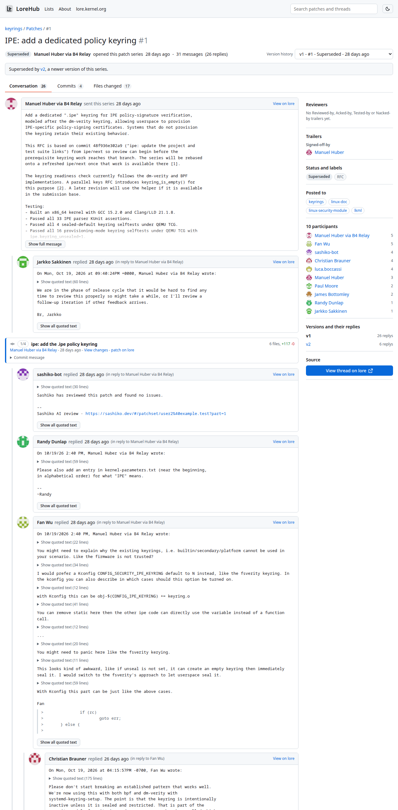
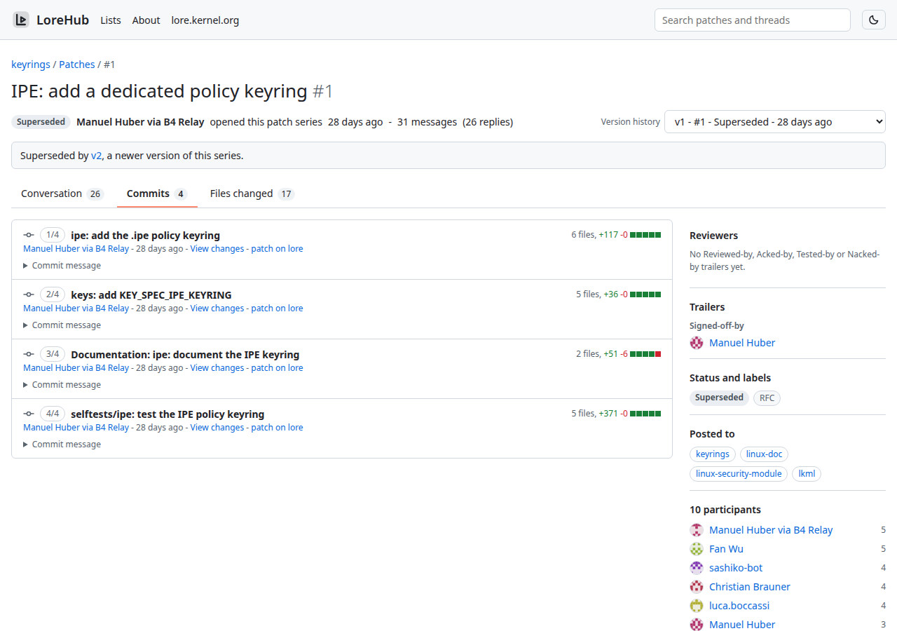
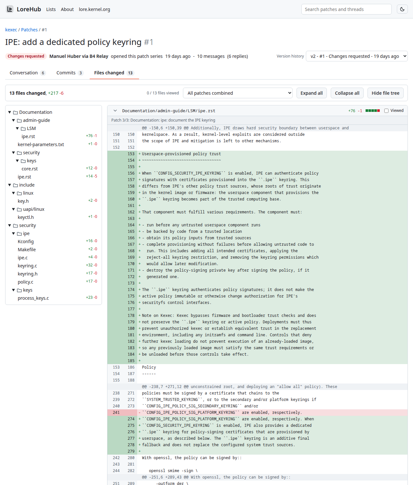
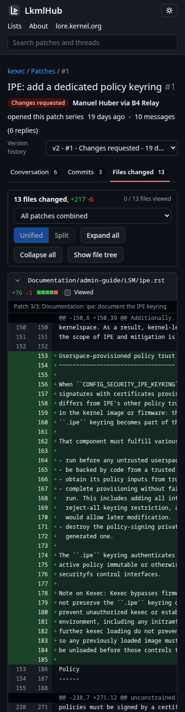

# LkmlHub

A GitHub-style view of every mailing list archived on [lore.kernel.org](https://lore.kernel.org/).

* a mailing list is a **repository**
* a patch series is a **pull request**, successive versions (v1, v2, v3) are one PR with a version history
* a non-patch thread is a **discussion** (issue)
* `Reviewed-by`, `Acked-by`, `Tested-by` and NAKs are **review states**
* "Applied, thanks" replies and `[GIT PULL]` threads are **merges**
* a pull request has the tabs **Conversation**, **Commits** and **Files changed**: the diff of the
  series (**Unified** or **Split**, see below) with a file tree, per-file cards and "Viewed" boxes, one patch at a time or all combined. **Only series with
  a stored diff are shown**, so "Files changed" is always there and always real (a series whose diff is not stored is
  not listed at all, in no count, feed, contributor page or search result)
* the **Conversation** is the whole thread: cover letter, every patch and every reply with its complete text (quotes
  collapsed behind a "Show quoted text" toggle, trailers highlighted), nested under the message it answers, replies to a
  patch under that patch, "in reply to" context, message count and participants
* conversations are **completed from lore's thread feeds**: series that look incomplete (a reply without its parent, a
  missing patch 3/7, a missing cover letter) are fetched whole, one request per series, from
  `https://lore.kernel.org/<list>/<message-id>/t.atom`. A series still waiting says "conversation still being completed"
* **search** (`#/search?q=ipe keyring`) over titles, patch subjects, authors and lists, from a static index
* a resumable **backfill** walks every list back **180 days**, so older series are found too

It is a fully static site: a Python generator (standard library only) writes JSON, and a small
vanilla JS front end renders it. No backend, no database, no tracker, no CDN. Deploys to GitHub Pages
under any sub-path (all links are relative, routes are hash based).


The series "ipe: add the .ipe policy keyring" (RFC v1 2026-10-19 with 31 messages, v2 2026-10-29), real data:

| Conversation (31 messages, light) | Conversation (dark) |
| --- | --- |
|  |  |

| Commits | Files changed |
| --- | --- |
|  |  |

| Conversation (phone) | Commits (phone, dark) | Files changed (phone, dark) |
| --- | --- | --- |
|  |  |  |

More screenshots (light and dark, desktop and mobile, of the three tabs; list page, search, contributor page,
served under a sub-path) are in [docs/screenshots](docs/screenshots). They were taken with headless Chrome from
real lore data: `lkml`, `netdev`, `linux-mm`, `bpf`, `linux-fsdevel`, `dri-devel`, `linux-riscv`, `stable`, and the
ipe series from linux-security-module and four lists it was cross-posted to (the acceptance fixture).

### Files changed: Unified and Split

The toolbar of the Files changed tab has a **Unified | Split** switch like GitHub's. It applies to every file card of the page at once.

* **Unified**: one column, old and new line numbers side by side (the default).
* **Split**: old on the left, new on the right, each side with its own line number gutter. Context lines show on both sides; in a
  change block the removed lines go left and the added lines right, paired by position, and the shorter side gets hatched empty
  cells without a number. Hunk headers span both columns, `\ No newline at end of file` stays on the side it belongs to. The
  changed characters inside a paired removed/added line get a stronger background (in both layouts; lines over 500 characters and
  pairs with nothing in common are left alone).
* The choice is remembered in `localStorage` (`lkmlhub-diff-layout`) for all series. A link can carry it: `...?tab=files&layout=split`
  (the URL wins over the stored choice and does not overwrite it).
* Below **900 px** window width only Unified is shown and the switch is disabled (with a tooltip saying why); the stored choice is
  kept and applies again on a wide screen.
* Wide lines scroll inside the file card, never the page; the split table scrolls as a whole. A file renders its first 2 000 rows,
  "Show N more lines" adds the next chunk (both layouts); collapsed files are rendered only when opened.

| Unified | Split |
| --- | --- |
|  |  |

## Run it locally

```sh
python3 -m lorehub all --lists lkml,netdev --out public --state state    # crawl, then build
python3 -m http.server -d public 8000                                     # open http://localhost:8000/
```

`all` is `crawl` followed by `build`. `build` alone rebuilds the site from an existing `state/` directory
without touching the network. Requires Python 3.10 or newer, nothing to install.

Useful options:

| Command | Option | Meaning |
| --- | --- | --- |
| crawl, all | `--lists a,b` | only these lists (default: every list in the manifest) |
| crawl, all | `--budget-min 25` | wall clock budget; unfinished lists are done by the next run |
| crawl, all | `--deep-budget N` | max search requests per run to sweep gaps on busy lists (default 12, 0 = off) |
| crawl, all | `--backfill-days 180` | history horizon in days, 0 turns the backfill off; the retention follows it (never below 180) |
| crawl, all | `--backfill-min 14` | backfill time budget per run (taken from `--budget-min`, the crawl has priority) |
| crawl, all | `--backfill-requests 900`, `--backfill-total 12000` | request caps per run and over all runs |
| crawl, all | `--backfill-list-pages 60` | pages of 200 entries per list, a safety cap (busy lists stop earlier, see below) |
| crawl, all | `--max-diff-msgs 1000` | patch messages per list that keep a diff, whole series newest first |
| crawl, all | `--complete-requests 300`, `--complete-min 8` | thread requests and minutes per run to complete incomplete series (0 = off) |
| crawl, all | `--max-state-mb 650` | data branch budget, above it the per list patch limit is lowered (0 = off) |
| complete | `--lists a,b --complete-requests 50` | run only the thread completion queue |
| crawl, all | `--from-cache DIR`, `--save-raw DIR` | replay or record raw HTTP responses, for offline development |
| build, all | `--out public` | output directory |
| build, all | `--base /lkmlhub/` | base path, used only by `404.html` |
| build, all | `--max-site-mb 700` | site size cap: above it whole series are left out, oldest closed ones first |
| backfill | `--lists a,b --backfill-days 30` | run only the backfill, for chosen lists |

## How the data is gathered

* The list of lists is `https://lore.kernel.org/manifest.js.gz`. Each list has one entry per
  public-inbox epoch; the newest `modified` time says when the list last changed.
* Per list activity comes from `https://lore.kernel.org/<list>/new.atom`. The feed carries, per message,
  author, subject, time, message-id (inside the link), the direct parent (`thr:in-reply-to`) and the
  complete text. **It holds only the 25 newest messages**, so LkmlHub accumulates history across runs and keeps
  **180 days** (the retention follows the configured horizon, never less than 180 days).
* A busy list can produce more than 25 messages between two runs (`lkml` peaks at 25 per 3.5 minutes).
  When a gap is detected the crawler sweeps it with the same host's search Atom, for patch related
  messages only (200 per request, about 1.2 MB), at most 12 requests per run (`--deep-budget`, repository
  variable `LOREHUB_DEEP_BUDGET`).
* **Backfill.** Every run, after the normal crawl, continues a resumable walk back in time through the search
  Atom of each list: `(dt:<from>..<to>) AND (s:PATCH OR s:RFC OR s:PULL OR s:RESEND OR s:ANNOUNCE)`, 200 entries per
  request, newest first, the next request starting where the last one ended (a per-list cursor in
  `state/meta.json`). The horizon is **180 days** (`LOREHUB_BACKFILL_DAYS`), small lists go first, at most 14 minutes
  and 900 requests per run and 12 000 in total. A list is finished when it reaches the horizon, or as soon as its newest
  1 000 patch messages with a diff are stored (older series would be dropped anyway), or at the safety cap of 60 pages.
  The full walk of all 359 lists is **about 2 900 requests** (3.4 GB raw, 0.83 GB on the wire), so a fresh deploy fills
  in over about four runs; the home page shows per list how far its history reaches. Replies keep the tag in their
  subject, so review threads come with the series. Request math and alternatives: [docs/DESIGN.md](docs/DESIGN.md).
* **Complete conversations (thread completion).** The search walk misses replies whose subject lost the patch tags
  and messages that fell into a gap. LkmlHub therefore detects incomplete series (a reply whose parent is not stored,
  numbered patches missing such as 3/7 of 1/7, 2/7, 4/7, no cover letter although the patches say N > 1 and one points to
  a missing parent) and fetches the whole thread of each from `https://lore.kernel.org/<list>/<message-id>/t.atom`, one
  request per series, newest and open series first, resumable, with its own budget (300 requests and 8 minutes per run,
  `LOREHUB_COMPLETE_REQUESTS`). A series waiting for that shows "conversation still being completed" and a link to the
  whole thread on lore; "Some messages could not be found on lore" means the thread was fetched and lore has no more.
  Measured: about 3 % of the series (1.6 to 6 % on six lists) are flagged, about 1 500 requests in total for 180 days.
* **Whole messages, whole series.** Every message of a shown series keeps its complete text (up to 128 KB per message, then
  flagged and linked to lore): quotes, trailers and signature included, only e-mail addresses removed. Retention works on
  whole series, newest first: a list keeps the newest series whose patches add up to 1 000 patch messages (first series
  always), with all their messages, bodies and diffs, or drops a series completely.
* **Only series with a diff are shown.** The "Files changed" tab of every pull request must have the real diff, so a
  series for which no diff is stored is not listed anywhere (not in the Patches tab or any count, the home page, the activity
  feed, contributor pages or search). If only some patches of a series have a diff the tab says which ("Diffs for patches 4-7
  are not stored, see lore"). `[GIT PULL]` requests have no diff and are listed as discussions.
* **Diffs.** The feed body carries the complete patch (checked on 1 469 real patches, the largest 1 MB), so no extra
  request is made. The diff is parsed into files (renames, new, deleted, binary, mode changes), cut at 120 KB per
  patch, stripped of e-mail addresses and kept on the data branch for the series of the newest 1 000 patch messages of each list.
* Polite by construction: User-Agent `lkmlhub-bot/0.1 (+https://github.com/lkmlhub/lkmlhub.github.io)`, at most
  2 concurrent requests, at least 0.5 s between request starts, `Retry-After` honoured, exponential
  backoff on 429/503/5xx, a hard stop if the server asks for a long pause, validators
  (`If-None-Match`, `If-Modified-Since`) sent when known, and lists whose manifest `modified` time did
  not change are skipped. lore currently sends no validators, so the manifest time does the work.
* Public-inbox git repositories are never cloned.
* The crawl is resumable: lists are processed least recently fetched first inside a time budget, and a
  failed or partial run never shrinks or corrupts the stored state. A list that could not be refreshed
  keeps its previous state and is flagged stale on the site. One pass over all 359 lists took about 3
  minutes and 60 MB.
* E-mail addresses are never stored or published. Authors are a salted, truncated SHA-256 of the
  address (12 hex characters, used for avatars and contributor pages); bodies are scrubbed; message-ids
  are stored percent-encoded.

## Heuristics

Everything below is guessed from reply text and can be wrong. The same table is on the site's About page.

| Label | Rule |
| --- | --- |
| Merged | a reply from someone other than the author says applied, queued, merged or pulled in its first lines (not a question, not negated), or a `[GIT PULL]` gets such a reply (or a pr-tracker-bot message) |
| Superseded | a newer version exists: same author, same normalised title, higher version, or a RESEND |
| Changes requested | a reply from someone else is a NAK, has a `Nacked-by`, or has inline comments containing requests, and that reviewer has not approved since; only while no newer version exists |
| Reviewed / Acked / Tested | a reply (not quoted) from someone other than the author carries that trailer |
| In review | any reply from someone other than the author |
| Open | no such reply yet |
| Stale | not merged or superseded, no activity for more than 60 days |

Priority: Merged, Superseded, Changes requested, Reviewed, Acked, Tested, In review, Open, then Stale on
top. Tabs show Open, Merged and Closed (superseded or stale) counts per list.

Series are detected from subjects such as `[PATCH v3 2/7]`, `[PATCH net-next v2 0/5]`, `[RFC PATCH]`,
`[RESEND PATCH]`, `[PATCH RFC]`, `[GIT PULL]`, `[PULL]`; `[ANNOUNCE]`, `[BUG]`, `[REGRESSION]` become
discussion labels. A cover letter and its patches form one PR; unthreaded series are joined by author,
version, total and time. A message cross-posted to several lists is one thread (keyed by message-id)
with the other lists shown as chips.

## Deploy to GitHub Pages

1. Push this repository to GitHub (the project page then lives at `https://<user>.github.io/<repo>/`).
2. Settings, Pages, Source: **GitHub Actions**.
3. Settings, Actions, General, Workflow permissions: allow read and write (the workflow also declares
   `contents: write`, `pages: write`, `id-token: write`).
4. Run the `update` workflow once from the Actions tab, or just push to `main`.

`.github/workflows/update.yml` runs in **chained cycles**: GitHub drops scheduled runs on busy days (one scheduled run in
13 hours was observed), so the last job of each run waits until a minimum cycle time (10 minutes, `LOREHUB_MIN_CYCLE_MINUTES`)
has passed since the run started and then dispatches the next run (`workflow_dispatch` from `GITHUB_TOKEN` is allowed to start
workflows). A cron entry every 20 minutes is only a watchdog that restarts the chain if it breaks; pushes to `main` and manual
dispatch also work. After a failed run the wait doubles. Stop the chain with the repository variable `LOREHUB_CHAIN=off` or the
`chain=false` dispatch input. Each run checks out `main`, checks out the `data` branch into a subdirectory (creating it on the
first run), runs the tests (on pushes only), crawls for up to 12 minutes (crawl, then backfill, then thread completion), builds
the site, pushes the data branch, uploads the Pages artifact and deploys it. A concurrency group prevents overlapping runs (one
running and at most one pending) and the build job has a **60 minute** timeout. Public repositories get unlimited free minutes
on standard runners and Actions based Pages deployments are not subject to the 10 builds per hour soft limit, so the cycle is
limited by the crawl politeness, not by CI minutes. **Data branch pushes:** a new orphan commit each run re-sends the whole
branch (git cannot use the server's copy of unrelated history: measured, 100 percent of the objects are sent again), which at
about 540 MB is too much, so a run adds one ordinary commit on top of `data` (only the changed day files are uploaded) and the
branch is squashed into one orphan commit once per UTC day, or earlier when the incremental commits since the last squash add up
to 300 MB (`LOREHUB_SQUASH_MB`; marker `state/.squashed` holds the date and the bytes sent). `.github/workflows/ci.yml`
runs the tests on pull requests for Python 3.10, 3.12 and the latest 3.x.

The base path is derived from the repository name (`/<repo>/`, or `/` for a `<user>.github.io`
repository). It only matters for `404.html`, which redirects `/<repo>/lkml/pr/3` to
`/<repo>/#/lkml/pr/3`. Everything else is relative, so moving to a custom domain or another sub-path
needs no code change: pass `--base` and redeploy.

The first run sees the newest 25 messages of each list and starts the backfill, so the site fills in over the
following runs: small lists within the first hours, the busiest ones last. **An already deployed `data` branch of an older
format is migrated, not discarded:** the state epoch (`state/meta.json`) is older, so every list's backfill cursor restarts from now,
records fetched again replace the old trimmed ones, series that have an old diff stay visible (with a "shortened copy" note on
messages that are not replaced yet), series without a diff are simply not shown until their list is walked again, and the home
page says that history is being rebuilt. The walk converges in about four runs and the thread completion in about five more.
Optional repository variables: `LOREHUB_BACKFILL_DAYS` (default 180, 0 = off), `LOREHUB_BACKFILL_MINUTES` (6), `LOREHUB_BUDGET_MINUTES` (12), `LOREHUB_MIN_CYCLE_MINUTES` (10), `LOREHUB_CHAIN` (on), `LOREHUB_SQUASH_MB` (300),
`LOREHUB_BACKFILL_TOTAL` (12000), `LOREHUB_BACKFILL_PAGES` (60), `LOREHUB_DEEP_BUDGET` (12), `LOREHUB_COMPLETE_REQUESTS` (200),
`LOREHUB_MAX_SITE_MB` (700), `LOREHUB_MAX_STATE_MB` (650).

**robots.txt:** `https://lore.kernel.org/robots.txt` currently disallows all crawlers (`User-agent: *`,
`Disallow: /`). LkmlHub only fetches the manifest and the Atom feeds, which the service does serve, with
an identifying User-Agent and a low request rate, but it does not read or obey robots.txt. Check with
the kernel.org admins that this use is acceptable before publishing, and see the cadence notes in
docs/DESIGN.md. The backfill makes the load heavier than the first version: about 2 900 search requests
(about 0.83 GB over the wire) spread over the first four runs plus about 1 500 thread requests (13 KB each on the wire),
then the sweep of busy lists (at most 12 requests per run) and a handful of thread requests. To stay with the light
crawl, set `LOREHUB_BACKFILL_DAYS=0`, `LOREHUB_COMPLETE_REQUESTS=0` and `LOREHUB_DEEP_BUDGET=0`.

## Tests

```sh
python3 -m unittest            # about 270 tests, 20 to 60 s (headless Chrome tests included when a browser is installed)
for f in site/assets/*.js; do node --check "$f"; done
```

Covered: diff parsing (renames, binary files, `\ No newline`, zero-context hunks, combined diffs, quoted diffs are
not patches), diff caps and truncation flags, complete bodies (quotes, trailers, the 128 KB cap and its flag), retention by whole
series (newest first, never partial, the 1000 patch limit, age follows the horizon, the state budget), the build time invariants
(every PR has a diff shard with a file, all counts equal the shown rows, nothing hidden leaks into the feed, contributors or
search, partial diffs, versions, size eviction by whole series), gap detection, the thread atom (a real `t.atom` fixture), the
completion queue (fake transport and fake clock: order, budgets, resume, failures), the state epoch migration (old state in, new behaviour
out, a partly migrated state builds a valid site), the backfill cursor (fake clock and fake transport: resume, budgets,
caps, failures, order), a real-data acceptance test on the ipe series (the reply counts equal the real thread: v1 26, v2 6;
Files changed with diffs for all patches of both versions), the size estimate script, the search index and the pure query function
(node), headless Chrome runs of the conversation (nesting, collapsed quotes, no overlap, no overflow at 1280 and 390 px) and of
the Files changed tab (unified and split layout, the stored preference and the URL parameter, the phone fallback, a 5 000 line file), the pure pairing function of the split layout (node), hostile mail and diffs, subject parsing, trailers, status heuristics, version linking, threading, cross-post
de-duplication, manifest and feed parsing, the polite fetcher (rate limit, Retry-After, backoff,
concurrency), state merging, failed crawls leaving state untouched, a smoke test that builds
the site from saved samples, no e-mail addresses in state, bodies, diffs, thread data or output (gzip files are unpacked for the
scan), escaping of hostile mail text, a lint against HTML injection sinks and third-party
origins, and a WCAG contrast check of every colour pair in both themes.

## Limitations

* **Statuses are heuristics.** People review off-list, apply patches silently, or phrase things in ways
  the rules do not see. Treat labels as hints, not facts.
* **History is bounded.** `new.atom` carries 25 messages; the backfill adds patch related mail back to 180 days
  (see above) but not threads without a patch tag, and not replies whose subject lost the tag unless the thread
  completion fetches them (it does for series that look incomplete; a series that looks complete but misses an
  edited-subject reply is not noticed: 0 of 83 sampled threads, but it is not impossible). Completeness is per list archive.
  The busiest lists (`lkml`, `netdev`, ...) keep only their newest 1 000 patch messages, a day or two for `lkml`. Every list
  card says how far its history reaches, every search page links to the same query on lore.kernel.org.
* **Series without a stored diff are not shown.** That includes old series of busy lists, series evicted when the site would
  pass 700 MB (oldest closed ones first, whole series), series whose patches carry no parseable diff, and the series of a list
  that the walk has not reached yet after an update of the data format. Diffs are at most 120 KB per patch and 600 KB per series
  (cut ones say so). Inline review comments are not attached to hunks (the Conversation tab shows the replies).
* **Limits.** Per list: the newest series with up to 1 000 patch messages with a diff (all their messages and bodies), 3 000 other
  messages, 100 published discussions. Expected size 540 MB data branch and 650 MB site (low 250 and 260, high 960 and 1170, where the
  caps (650 MB state budget, 700 MB site) trim whole series). Details in [docs/DESIGN.md](docs/DESIGN.md).
* **Messages** are complete up to 128 KB (longer ones are cut and say so). A message of an older format that has not been
  replaced yet is a shortened copy and says so. A reply sent to another list only is not in this list's thread.
* Subsystem colours are guessed from list names. Open counts include threads whose first message is
  outside the window.
* The About page, status names and tabs are in English only.

## Layout

```
lorehub/      generator: manifest, fetch, feed, parse, diff, diffshards, model, state, retention, migrate, crawl, backfill, complete, search, build, groups, CLI
site/         static front end (index.html, assets/*.js, style.css)
tests/        unittest suite and sanitised fixtures
scripts/      estimate_size.py
docs/         DESIGN.md, PROGRESS.md, screenshots
.github/      update.yml (schedule, crawl, deploy) and ci.yml (tests)
```

See [docs/DESIGN.md](docs/DESIGN.md) for the architecture and data model.

## Credits

All mail belongs to its authors and is served by lore.kernel.org, powered by
[public-inbox](https://public-inbox.org/). Related tools with different jobs:
[patchwork](https://patchwork.kernel.org/) (patch state for some lists), [b4](https://b4.docs.kernel.org/)
and [korgalore](https://korg.docs.kernel.org/) (command line tools), and plain archives such as lkml.org
and spinics. LkmlHub is not affiliated with any of them.

## Licence

MIT, see [LICENSE](LICENSE).
